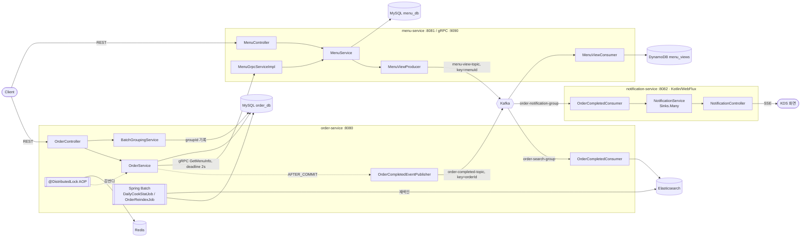

# Predictive KDS & Order Batching

> 주방에서 겪은 배치 조리 문제를 **신호 감지(Kafka) → 배치 처리 → 동시성 방어(Redis) → 성능 증명(k6) → 실무 구조화(gRPC/CI-CD)** 로 풀어내는 주방 디스플레이 시스템(KDS) 백엔드

피크타임에 같은 메뉴 주문이 따로따로 들어오면 주방은 같은 조리를 여러 번 반복합니다. 이 프로젝트는 "손님이 메뉴를 보는 순간"부터 신호를 모으고, 같은 메뉴 주문을 묶어 한 번에 조리하도록 안내하며, 주문이 몰려도 데이터가 꼬이지 않게 지키는 것을 목표로 합니다.

4주 계획으로 진행 중이며, **현재 3주차까지 구현되어 있습니다.**

## 진행 현황

| 주차 | 주제 | 상태 |
| --- | --- | --- |
| 1주차 | Spring Boot CRUD → Gradle 멀티모듈 분리 → gRPC 통신 | ✅ 완료 |
| 2주차 | Kafka + DynamoDB 이벤트 파이프라인, Redis 분산락 | ✅ 완료 |
| 3주차 | 배치 그룹핑, WebFlux/SSE 실시간 알림, Spring Batch 통계, Elasticsearch, Kotlin | ✅ 완료 |
| 4주차 | k6 부하테스트, Resilience4j, Prometheus/Grafana/Loki, CI/CD, EC2 배포 | ⏳ 예정 |

## 아키텍처 (현재 구현 기준)



- **주문 생성**: `order-service`가 메뉴별 분산락을 잡고, gRPC로 `menu-service`에 메뉴 정보를 물어본 뒤 메뉴 이름·가격 스냅샷과 함께 주문을 저장합니다. 커밋된 주문은 `BatchGroupingService`의 메뉴별 바구니에 담깁니다.
- **배치 그룹핑**: 같은 메뉴 수량이 임계치(5개)에 도달하면 즉시, 아니면 30초 윈도우마다 묶어서 KDS로 전송하고 묶인 주문들에 같은 `groupId`를 기록합니다.
- **주문 완료**: 상태가 `COMPLETED`로 바뀌면 커밋 후 `order-completed-topic`에 이벤트를 발행합니다. 같은 이벤트를 두 컨슈머 그룹이 각각 받아 **ES 색인**과 **KDS 실시간 알림(SSE)** 에 사용합니다.
- **야간 배치**: 매일 00:10 일일 조리 통계(절감된 조리 횟수)를 집계하고, 03:30 전날 완료된 주문을 MySQL 기준으로 ES에 재색인합니다.
- **메뉴 조회**: `menu-service`가 메뉴를 반환하면서 조회 이벤트를 Kafka에 발행하고, Consumer가 이를 DynamoDB에 적재합니다. 이벤트 발행·적재가 실패해도 메뉴 조회 자체는 정상 응답합니다.

## 기술 스택

| 구분 | 사용 기술 |
| --- | --- |
| 언어 / 프레임워크 | Java 17, Kotlin 2.2.20, Spring Boot 3.3.0, Spring Data JPA, Spring AOP, Spring WebFlux |
| 배치 | Spring Batch (Chunk 지향 처리, Tasklet) |
| 빌드 | Gradle 9.7.1 (멀티모듈) |
| 서비스 간 통신 | gRPC 1.60.0, Protocol Buffers 3.25.3 |
| 메시징 | Apache Kafka 3.8.0 (KRaft 모드) |
| 저장소 | MySQL 8.0, DynamoDB Local, Redis 7.2 (Redisson 3.37.0), Elasticsearch 8.13.4 |
| 테스트 | JUnit 5, AssertJ, Mockito, Kotest 5.9.1, Reactor Test, Spring Batch Test, H2 |

## 모듈 구조

```
kds-order
├── common                # menu.proto 및 생성된 gRPC stub (두 서비스가 공유하는 통신 규격)
├── menu-service          # 메뉴 CRUD, gRPC 서버, 조회 이벤트 Producer/Consumer, DynamoDB 적재
├── order-service         # 주문 CRUD, gRPC 클라이언트, @DistributedLock AOP
│   ├── batch             #   배치 그룹핑 (메뉴별 묶음 → KDS 전송, groupId 기록)
│   ├── stat              #   일일 조리 통계 배치 (Spring Batch)
│   ├── search            #   ES 색인 Consumer, 주문 검색 API, 재색인 배치
│   └── event             #   주문 완료 이벤트 발행 (order-completed-topic)
├── notification-service  # Kotlin + WebFlux, 주문 완료 이벤트 구독 → SSE로 KDS에 실시간 알림
├── docker                # MySQL 초기화 스크립트 (menu_db, order_db 생성)
└── docs
    ├── decisions         # 설계 결정 기록 (ADR)
    ├── study-log         # 일일 학습 기록
    └── weekly-retro      # 주간 아키텍처 회고
```

서비스끼리는 서로를 직접 참조하지 않고 `common`의 proto 규격(gRPC)이나 Kafka 토픽으로만 대화합니다. 각 서비스는 자기 DB(`order_db`, `menu_db`)만 소유합니다.

## 실행 방법

**사전 준비:** JDK 17, Docker

```bash
# 1. 인프라 기동 (MySQL, Kafka, DynamoDB Local, Redis, Elasticsearch)
docker compose up -d

# 2. 서비스 기동 (터미널 3개)
./gradlew :menu-service:bootRun
./gradlew :order-service:bootRun
./gradlew :notification-service:bootRun
```

| 대상 | 포트 |
| --- | --- |
| order-service (REST) | 8080 |
| menu-service (REST) | 8081 |
| notification-service (REST/SSE) | 8082 |
| menu-service (gRPC) | 9090 |
| MySQL | 3307 |
| Kafka | 9092 |
| DynamoDB Local | 8000 |
| Redis | 6379 |
| Elasticsearch | 9200 |

**KDS 실시간 알림 확인**

```bash
# 터미널 A: KDS처럼 SSE 구독
curl -N http://localhost:8082/api/v1/notifications/orders

# 터미널 B: 주문을 완료 처리하면 터미널 A에 알림이 뜬다
curl -X PATCH "http://localhost:8080/api/orders/1/status?status=COMPLETED"
```

**테스트**

```bash
./gradlew test
```

- `order-service`의 통합 테스트는 MySQL, Redis, Kafka, Elasticsearch가 떠 있어야 합니다. 배치 그룹핑 테스트(`BatchGroupingServiceTest`, `BatchWindowComparisonTest`)와 통계 Reader 테스트는 인프라 없이 실행됩니다.
- `menu-service`의 gRPC 테스트는 인프라 없이 실행됩니다.
- `notification-service`는 Kotest(`BehaviorSpec`, `FunSpec`)로 작성되어 있습니다.

## API

요청 값은 모두 쿼리 파라미터로 받습니다. (테스트용 알림 발행 API만 JSON 본문)

**Menu Service** (`http://localhost:8081`)

| Method | Path | 설명 |
| --- | --- | --- |
| POST | `/api/menus?name=&price=&cookingTime=` | 메뉴 생성 |
| GET | `/api/menus` | 메뉴 전체 조회 |
| GET | `/api/menus/{menuId}` | 메뉴 단건 조회 (조회 이벤트 발행) |
| PATCH | `/api/menus/{menuId}/price?newPrice=` | 가격 수정 |
| DELETE | `/api/menus/{menuId}` | 메뉴 삭제 |

**Order Service** (`http://localhost:8080`)

| Method | Path | 설명 |
| --- | --- | --- |
| POST | `/api/orders?menuId=&quantity=` | 주문 생성 (분산락 + gRPC 메뉴 조회 + 배치 그룹핑) |
| GET | `/api/orders` | 주문 전체 조회 |
| GET | `/api/orders/{orderId}` | 주문 단건 조회 |
| PATCH | `/api/orders/{orderId}/status?status=` | 주문 상태 변경 (`PENDING`, `COOKING`, `COMPLETED`, `CANCELED`). `COMPLETED` 전환 시 완료 이벤트 발행 |
| DELETE | `/api/orders/{orderId}` | 주문 삭제 |
| GET | `/api/orders/search?keyword=&status=&page=&size=` | 메뉴 이름으로 완료 주문 이력 검색 (Elasticsearch) |
| GET | `/api/stats/daily-cook?date=` | 일일 조리 통계 조회 (`ACTIVE` 통계만) |
| POST | `/api/batch/cook-stat?targetDate=` | 일일 조리 통계 배치 수동 실행 |
| POST | `/api/batch/order-reindex?targetDate=` | ES 재색인 배치 수동 실행 |

**Notification Service** (`http://localhost:8082`)

| Method | Path | 설명 |
| --- | --- | --- |
| GET | `/api/v1/notifications/orders` | 주문 알림 SSE 구독 (KDS용) |
| POST | `/api/v1/notifications/test` | 테스트용 알림 발행 (예: `{"menuId":1,"message":"주문 #1 아메리카노"}`) |
| GET | `/api/v1/notifications/stream` | 하트비트 SSE (1초 간격) |
| GET | `/api/notifications/health` | 헬스 체크 |

**gRPC** (`common/src/main/proto/menu.proto`)

```protobuf
service MenuGrpcService {
  rpc GetMenuInfo (MenuRequest) returns (MenuResponse);
}
```

`MenuResponse`는 `menu_id`, `menu_name`, `price`, `cooking_time`, `menu_status`를 담습니다.

## 핵심 설계 결정

### 1. 단일 모듈로 시작해서 멀티모듈로 분리
처음부터 나누지 않고 단일 프로젝트로 CRUD를 완성한 뒤 `order-service` / `menu-service` / `common`으로 쪼갰습니다. 패키지 분리는 컴파일 시점의 격리를 강제하지 못하지만, Gradle 멀티모듈은 `build.gradle`에 선언하지 않은 모듈을 `import`조차 할 수 없어 의존성 경계가 물리적으로 지켜집니다.

### 2. 내부 통신은 gRPC + Deadline
서비스 간 호출은 Protocol Buffers 바이너리 직렬화와 HTTP/2 기반의 gRPC를 사용합니다. `menu-service`가 느려져도 `order-service`의 스레드가 묶이지 않도록 호출마다 2초 Deadline을 겁니다.

Deadline은 stub 빈 생성 시점이 아니라 **호출 시점마다** 새로 설정합니다. 빈 생성 시 걸어두면 앱 기동 2초 이후의 모든 호출이 즉시 타임아웃 나기 때문입니다 (`GrpcClientConfig`, `OrderService.fetchMenuInfo`).

### 3. 조회 이벤트는 Kafka로 분리하고 DynamoDB에 적재
메뉴 반환(핵심 흐름)과 조회 기록(부가 기능)을 분리했습니다.

- 파티션 키로 `menuId`를 사용해 같은 메뉴의 이벤트 순서를 보장합니다.
- Kafka 발행 실패와 DynamoDB 저장 실패는 각각 로그만 남기고 삼킵니다. 조회수는 일부 유실을 감수할 수 있는 데이터이고, 예외가 전파되면 메뉴 조회가 실패하거나 컨슈머가 같은 메시지를 무한 재시도하게 됩니다.
- 정합성이 중요한 주문·메뉴 데이터는 MySQL, 쓰기가 잦고 조회 패턴이 단순한 이벤트 로그는 DynamoDB(PK `menuId`, SK `viewedAt`)에 저장합니다.

### 4. `@DistributedLock` — 어노테이션 기반 분산락
메서드에 어노테이션만 붙이면 Redisson 락이 적용됩니다. 키는 SpEL로 메서드 인자를 참조합니다.

```java
@DistributedLock(key = "'MENU_ORDER_COUNT_LOCK_' + #menuId", waitTime = 10000, leaseTime = 3000)
@Transactional
public void increaseCount(Long menuId) { ... }
```

락 Aspect에는 `@Order(Ordered.HIGHEST_PRECEDENCE)`를 부여해 **락이 트랜잭션을 바깥에서 감싸도록** 했습니다. 실행 순서는 `락 획득 → 트랜잭션 시작 → 로직 → 커밋 → 락 해제`입니다.

### 5. 주문 시점 스냅샷
주문 시점의 메뉴 이름과 가격을 `Order`에 복사해 둡니다(`menuName`, `price`). 과거 주문 금액의 불변성을 지키고, 배치 그룹핑·검색 색인 때 매번 `menu-service`를 호출하지 않기 위해서입니다. 근거는 [ADR 001](docs/decisions/001-order-item-snapshot-pattern.md)에 있습니다. 현재는 별도 `OrderItem` 엔티티 없이 `Order`에 컬럼으로 두었고, 이 컬럼이 생기기 전의 주문은 `null`입니다.

### 6. 배치 그룹핑 — Size 임계치 + 고정 Time 윈도우
주문을 바로 KDS로 보내지 않고 메뉴별 바구니(`ConcurrentHashMap`)에 모읍니다.

- **Size 방어:** 같은 메뉴 수량이 임계치(`kds.batch.threshold=5`)에 도달하면 윈도우를 기다리지 않고 즉시 전송합니다.
- **Time 방어:** `@Scheduled(fixedRate=30s)`마다 임계치에 못 미친 자투리 주문을 강제로 비웁니다. 어떤 주문도 윈도우보다 오래 기다리지 않습니다.
- **원자성:** "누적 → 임계치 확인 → 제거"를 `compute()` 한 번으로 처리하고, 윈도우 비우기는 키마다 `remove()`로 꺼내면서 지웁니다. 복사 후 `clear()`하면 그 사이에 들어온 주문이 유실되기 때문입니다.
- **락 밖에서 전송:** KDS 전송(I/O)은 `compute()`의 bin 락이 풀린 뒤에 합니다. 전송이 느려져도 같은 칸의 다른 주문이 멈추지 않습니다.
- **트랜잭션 커밋 후 담기:** 컨트롤러에서 `createOrder`가 커밋된 뒤에 바구니에 담아, 롤백된 주문이 주방으로 가지 않게 했습니다.
- 묶음마다 `groupId`(UUID)를 만들어 주문에 기록합니다. 이 값이 일일 통계에서 "실제 조리 횟수"의 기준이 됩니다.

같은 주문 흐름(10분, 406건)을 윈도우 크기별로 흘려본 결과입니다 (`BatchWindowComparisonTest`, 시드 고정 시뮬레이션):

| 윈도우 | KDS 전송 | Size / Time | 평균 묶음 | 최대 대기 | 비인기 메뉴 평균 대기 |
| --- | --- | --- | --- | --- | --- |
| 배치 없음 | 406회 | - | 1건 | 0초 | 0초 |
| 30초 | 137회 | 96 / 41 | 4.50개 | 29초 | 13.7초 |
| 1분 | 130회 | 103 / 27 | 4.75개 | 59초 | 35.1초 |
| 2분 | 121회 | 108 / 13 | 5.10개 | 119초 | 68.0초 |

윈도우를 30초 → 2분으로 늘려도 전송 횟수는 12% 정도만 줄지만, 비인기 메뉴의 대기 시간은 5배로 늘어납니다. 인기 메뉴는 대부분 Size 트리거로 나가기 때문입니다. 그래서 기본 윈도우를 **30초**로 정했습니다.

### 7. 실시간 알림 — WebFlux + SSE (Kotlin)
KDS는 주문 알림을 받기만 하면 되므로 양방향 WebSocket 대신 HTTP 기반 단방향 SSE를 사용합니다. 연결을 오래 쥐고 있어야 하므로 커넥션마다 스레드를 묶는 MVC(Tomcat) 대신 이벤트 루프 기반 WebFlux(Netty)를 선택했습니다.

- `Sinks.many().multicast()`로 연결된 모든 KDS에 같은 알림을 브로드캐스트합니다.
- `autoCancel=false`로 생성해, 영업 종료로 모든 KDS가 끊겨도(구독자 0명) Sink가 종료되지 않게 했습니다.
- 구독 직후 SSE 주석(`: connected`)을 하나 내려서 응답 헤더를 즉시 보냅니다. Sink가 비어 있으면 첫 알림 전까지 헤더조차 나가지 않기 때문입니다.
- Kafka 리스너 스레드와 테스트 POST 요청이 동시에 `tryEmitNext()`를 호출하면 `FAIL_NON_SERIALIZED`로 실패하므로, `publish()`를 `@Synchronized`로 직렬화했습니다.
- 알림은 "지금" 띄우는 용도라 컨슈머는 `auto-offset-reset=latest`, 실패 시 재시도/DLT 없이 로그만 남깁니다. 재시도하는 동안 파티션이 막혀 뒤 알림까지 늦어지는 게 더 나쁘다고 판단했습니다.
- 모듈 하나를 Kotlin으로 옮길 때 기존 Java 모듈에 섞지 않고 `notification-service`를 **순수 Kotlin 모듈로 분리**했습니다. Lombok과 Kotlin 컴파일 순서 충돌(KAPT 설정)을 피하기 위해서입니다. Kotlin 클래스는 기본이 `final`이라 `kotlin-spring` 플러그인으로 스프링 빈을 자동 `open` 처리합니다.

### 8. 일일 조리 통계 — Spring Batch + PENDING/ACTIVE 스왑
매일 00:10 전날 주문을 집계해 메뉴별 `주문 건수 / 실제 조리 횟수(서로 다른 groupId 수) / 절감된 조리 횟수`를 적재합니다.

- **Chunk 지향 처리:** `JpaPagingItemReader`로 100건씩 읽습니다. 집계는 `COUNT`, `COUNT(DISTINCT groupId)`, `GROUP BY menuId`로 DB에 맡겨 서버 메모리에는 작은 DTO(`CookStatRow`)만 올라옵니다. 원본 `orders`를 읽기만 하므로 페이징 중 데이터가 바뀌어 누락되는 문제도 없습니다.
- **무중단 재처리:** 기존 통계를 지우고 다시 쌓으면 집계 중 실패했을 때 대시보드가 비어 버립니다. 그래서 새 결과는 `PENDING`으로 넣고, 마지막 Tasklet Step 한 트랜잭션 안에서 `기존 ACTIVE → INACTIVE`, `이전 실행의 PENDING 찌꺼기 삭제`, `이번 실행의 PENDING → ACTIVE`를 실행합니다. 실패하면 통째로 롤백되어 기존 통계가 그대로 유지됩니다.
- 실행마다 `jobExecutionId`를 행에 기록해, 이전에 실패한 실행이 남긴 `PENDING`을 자동으로 정리합니다.
- JobParameters에 타임스탬프를 넣어 같은 날짜를 다시 돌릴 수 있게 했습니다.

### 9. 주문 이력 검색 — Kafka 비동기 색인 + 재색인 배치
MySQL은 쓰기/트랜잭션, Elasticsearch는 검색을 맡습니다. 원본(Single Source of Truth)은 MySQL입니다.

- **커밋 후 발행:** `@TransactionalEventListener(AFTER_COMMIT)`으로 상태 변경이 커밋된 뒤에만 이벤트를 발행해, 롤백된 "가짜 완료"가 색인되지 않게 했습니다.
- **재시도 + DLT:** ES 저장 실패 시 1초부터 2배씩 최대 4번 재시도(지수 백오프)하고, 최종 실패하면 DLT로 격리합니다. JSON 파싱 오류는 재시도해도 소용없으므로 바로 DLT로 보냅니다. DLT에는 원본 문자열이 그대로 남도록 전용 전송기를 두었습니다(기본 JsonSerializer는 문자열을 한 번 더 감쌉니다).
- **재색인 배치:** 매일 03:30 전날 완료된(`completedAt`) 주문을 500건씩 읽어 ES에 다시 저장합니다. ES 문서 ID를 MySQL PK와 맞춰 이미 있는 문서는 덮어쓰기 때문에 몇 번을 돌려도 결과가 같습니다. 실시간 경로와 같은 변환(`OrderDocument.from`)을 씁니다.
- **검색 쿼리:** `menuName`은 `must + match`(형태소 분석·점수 반영), `status`는 `filter + term`(정확 일치, 점수 계산 없음)으로 나눴습니다.
- 재색인 기준을 `createdAt`이 아니라 `completedAt`으로 잡았습니다. 자정 직전에 주문하고 다음 날 완료된 건이 빠지지 않게 하기 위해서입니다.

## 트러블슈팅

### 분산락을 걸었는데도 데이터가 오염됨
- **증상:** 락을 적용했는데도 간헐적으로 카운트가 맞지 않음.
- **원인:** 락 AOP가 `@Transactional`보다 안쪽에서 실행되어, DB 커밋 전에 락이 먼저 풀렸습니다. 그 틈에 다른 스레드가 커밋되지 않은 옛 값을 읽었습니다.
- **해결:** 락 Aspect의 우선순위를 최상위로 올려 커밋이 끝난 뒤에 락이 풀리도록 순서를 강제했습니다.

### 100건을 보냈는데 98건만 반영되는 불안정한 테스트
- **증상:** 실행할 때마다 결과가 달라짐.
- **원인:** `ExecutorService.submit()`이 예외를 삼켜 원인이 보이지 않았습니다. `Future.get()`으로 예외를 끌어올리자 `락 획득 실패`가 드러났고, 줄 맨 뒤의 스레드가 `waitTime`을 넘겨 탈락한 것이었습니다.
- **해결:** `waitTime`을 0으로 줄여 실패를 의도적으로 재현해 원인을 확정한 뒤, "카운트는 누락 없이 처리되어야 한다"는 요구에 맞춰 `waitTime`을 10초로 늘렸습니다.

### `@annotation(파라미터)` 바인딩이 동시 호출에서 깨짐
- **증상:** 동시 호출 시 `Required to bind 2 arguments, but only bound 1` 예외가 무작위로 발생.
- **해결:** 포인트컷은 어노테이션 타입으로만 매칭하고, 어노테이션 값은 advice 안에서 리플렉션으로 직접 꺼내도록 바꿨습니다.

### Kafka 연결 오류 (`Connection to node -1 could not be established`)
- **원인:** Zookeeper 컨테이너가 먼저 죽으면서 Kafka가 연쇄 종료되었습니다.
- **해결:** Zookeeper가 필요 없는 KRaft 모드 이미지(`apache/kafka:3.8.0`)로 교체했습니다.

### 모든 KDS가 끊긴 다음 날 알림이 오지 않음
- **증상:** 구독자가 0명이 된 뒤 다시 접속하면 알림이 전혀 오지 않음.
- **원인:** `Sinks.many().multicast().onBackpressureBuffer()`의 기본값은 `autoCancel=true`라, 마지막 구독자가 떠나면 Sink가 종료됩니다.
- **해결:** `autoCancel=false`로 생성해 서버 재시작 없이도 Sink가 계속 살아 있게 했습니다.

### 동시 발행 시 알림 유실 (`FAIL_NON_SERIALIZED`)
- **증상:** Kafka 리스너와 POST API가 동시에 알림을 넣으면 하나가 조용히 실패함.
- **원인:** `tryEmitNext()`는 동시 호출을 허용하지 않고, 예외 대신 결과 코드를 돌려줍니다.
- **해결:** `publish()`를 `@Synchronized`로 직렬화했습니다. 논블로킹 대안인 `EmitFailureHandler.busyLooping()`도 검토했습니다.

### SSE 연결 직후 클라이언트가 연결 여부를 모름
- **원인:** Sink에 데이터가 없으면 첫 요소가 나갈 때까지 응답 헤더가 전송되지 않습니다.
- **해결:** 구독 직후 SSE 주석(`: connected`)을 `Flux.merge`로 함께 내려보내 헤더를 즉시 전송합니다. 주석은 `EventSource.onmessage`로 전달되지 않아 클라이언트 로직에 영향이 없습니다.

### 동시성 테스트 결과

| 조건 | 100건 동시 요청 결과 |
| --- | --- |
| 락 없음 | TBD (재현 수치 기록 예정) |
| 락 적용, `waitTime` 부족 | 98건 반영된 실행 관측 (결과가 매번 달라짐) |
| 락 적용, AOP 순서 미지정 | 간헐적 오염 |
| 락 적용, `waitTime` 10초 + `@Order` 최상위 | 100건 반영 (`OrderCountServiceTest`) |

## 알려진 한계

**구조 / 통신**
- **로컬 모듈 분리 수준입니다.** 서비스 디스커버리 없이 주소를 설정 파일에 고정했고, 실제 다중 서버 배포는 아닙니다.
- **`createOrder`는 락과 트랜잭션을 잡은 채로 gRPC를 호출합니다.** `menu-service`가 느려지면 락 점유 시간이 함께 늘어납니다.
- **gRPC 재시도가 없습니다.** 현재는 Deadline만 적용되어 있고, 서킷브레이커는 4주차에 추가합니다.
- **Redis 장애 시 락을 획득할 수 없습니다.** 대체 경로는 없습니다.

**주문 / 배치 그룹핑**
- **주문 생성 시 품절 여부를 검증하지 않습니다.** gRPC 응답에 `menu_status`를 채우지 않아 항상 기본값(`AVAILABLE`)이 내려갑니다.
- **주문 생성과 주문 수 카운트가 아직 연결되어 있지 않습니다.** `OrderCountService.increaseCount`는 동시성 검증용으로 단독 테스트되며, `createOrder`에서 호출하지 않습니다.
- **배치 묶음은 아직 KDS 화면으로 가지 않습니다.** `KdsSender` 구현체는 로그만 남기는 `LoggingKdsSender`이고, SSE로 나가는 알림은 주문 *완료* 이벤트입니다.
- **배치 바구니가 인스턴스 메모리에 있습니다.** 서버가 재시작되면 아직 전송되지 않은 주문이 사라지고, 여러 대로 늘리면 같은 메뉴 주문이 서버별로 따로 묶입니다.

**알림**
- **알림 서버를 여러 대로 늘릴 수 없습니다.** 컨슈머 그룹 ID가 고정(`order-notification-group`)이라 늘리면 메시지가 서버별로 나뉩니다. 서버마다 고유한 그룹 ID가 필요합니다.
- **놓친 알림을 다시 받을 수 없습니다.** 연결이 끊긴 동안 발생한 알림은 재전송하지 않습니다.

**검색 / 통계**
- **완료 이후의 변경이 ES에 반영되지 않습니다.** `COMPLETED`에서 다른 상태로 바뀌거나 삭제된 주문의 문서는 그대로 남습니다.
- **DLT 자동 재처리가 없습니다.** DLT는 원인 조사용 보관함이며, 누락분은 재색인 배치가 MySQL 기준으로 메웁니다.
- **재시도 중에는 같은 파티션의 다음 메시지가 대기합니다.** `@RetryableTopic`으로 재시도 토픽을 분리하는 것을 검토 중입니다.
- **`completedAt` 도입 전에 완료된 주문은 재색인 대상에서 빠집니다.** 별도 마이그레이션(`UPDATE orders SET completed_at = created_at WHERE status = 'COMPLETED' AND completed_at IS NULL`)이 필요합니다.
- **`groupId` 도입 전 주문은 통계의 실제 조리 횟수에 잡히지 않습니다.** `COUNT(DISTINCT groupId)`는 `null`을 세지 않습니다.

**메뉴 조회 이벤트**
- **DynamoDB 핫파티션 가능성.** 파티션 키가 `menuId`라 인기 메뉴에 쓰기가 쏠릴 수 있습니다.
- **Consumer가 단건 처리입니다.** 메시지 1건당 `putItem` 1회이며, BatchListener + `batchWriteItem` 전환을 TODO로 남겼습니다.

## 로드맵

**4주차 — 성능 증명 + 장애 대응 + 배포 자동화**
- k6로 배치 적용 전/후 부하테스트
- Order → Menu gRPC 호출부에 Resilience4j 서킷브레이커
- Actuator + Micrometer, Prometheus / Grafana / Loki
- CI/CD 파이프라인, EC2 자동 배포

## 문서

- [설계 결정 기록 (ADR)](docs/decisions)
- [주간 아키텍처 회고](docs/weekly-retro)
- [일일 학습 기록](docs/study-log)
